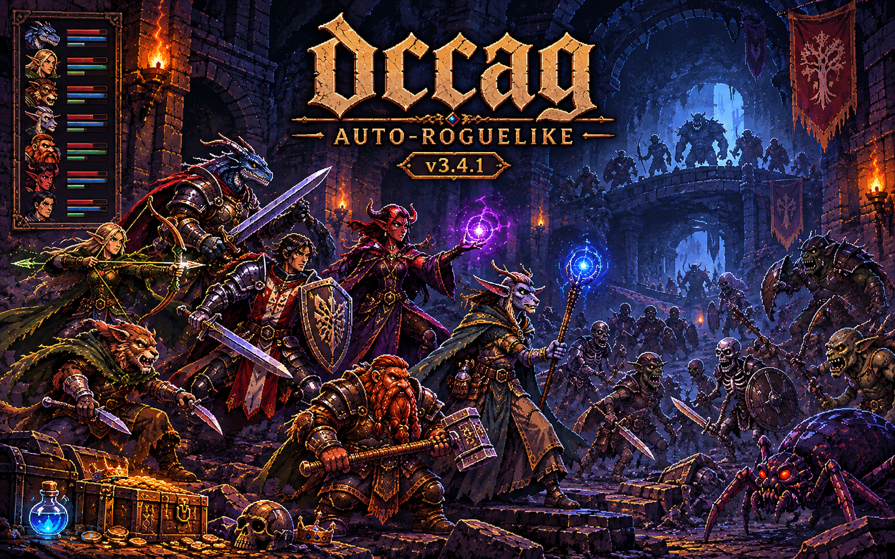

<p align="center">
  
</p>

# dccag

**A terminal auto-roguelike about a party of adventurers exploring a dangerous, procedurally generated dungeon.**

Build a party, prepare it in the Capital, and send it deeper into the dungeon. By default, the expedition runs on autopilot: the party explores, fights, gathers loot, completes contracts, and returns to the Capital to recover and improve its equipment. You can also switch to manual control and take charge of movement and combat yourself.

dccag is written in Go and uses a keyboard-driven terminal interface.

## Gameplay

Each expedition connects two parts of the game:

- **The Capital.** A walkable town with a Market, Magistrate, Church, Tavern, Guild, Forge, Tannery, Alchemist and the Dungeon Gate. The party visits services, sells loot, hires companions, improves equipment and prepares for another descent.
- **The Dungeon.** Procedurally generated floors with different biomes, monster packs, bosses, events, quests, secrets, relics and lore. The deeper the party goes, the more dangerous the expedition becomes.

The default mode is an **auto-roguelike**: the party makes its own decisions and the run progresses automatically. Manual mode is available when you want direct control.

## Characters

- **7 playable races:** Human, Elf, Beastman, Olongr, Dwarf, Demonkin and Dragonkin.
- **10 classes**, with distinct combat roles, skills and synergies.
- Create a custom hero and save its blueprint for future parties.
- Recruit up to four companions for a custom leader.
- Heroes develop through experience, equipment, mutations, conditions and racial or class traits.

## Systems and features

- Procedural dungeon generation and multiple biomes.
- Party combat with roles, skills, status effects, monster affixes and roaming packs.
- Equipment with materials, bonuses, affixes and weapon enchantments.
- Legendary relics with active gameplay effects.
- Capital services, economy, crafting and party preparation.
- Guild contracts, quests, achievements and expedition statistics.
- Capital Library: discover and read lore that can unlock gameplay rewards.
- Adaptive terminal layouts for different window sizes.
- Russian, English and Belarusian interface, switchable in-game.
- Reproducible runs with a chosen random seed.

## Screens and controls

The game is keyboard-driven. The on-screen hints show the controls available in the current screen.

| Key | Action |
| --- | --- |
| `M` | Toggle manual control mode |
| `L` | Switch interface language |
| `B` | Open the Capital Library |
| `P` | Open the heroes window |
| `H` | Open the heroes window while manual combat controls use `P` for potions |
| Arrow keys | Move in the Capital or, in manual mode, through the dungeon |
| `A` | Basic attack in manual combat |
| `Space` | Use the hero's class skill in manual combat |
| `D` | Take a defensive stance in manual combat |
| `F` | Attempt to flee from combat |
| `←` / `→` | Select an enemy target in manual combat |

In manual mode, the Capital still runs automatically; direct movement and combat control apply to the dungeon.

## Run

### Requirements

- Go 1.24 or newer to build from source.

### Build and start

```bash
git clone https://github.com/JstexKU/dccag.git
cd dccag
go build -o dccag .
./dccag
```

You can also run it directly without creating a binary:

```bash
go run .
```

## Command-line options

| Option | Description |
| --- | --- |
| `-version` | Print the game version and exit |
| `-manual` | Start in manual control mode |
| `-seed <number>` | Use a specific random seed for a reproducible run |
| `-no-save` | Disable reading and writing the optional save file |
| `-reset-save` | Remove the save file and exit |
| `-report` | Write an expedition telemetry report to `dccag_report.json` on exit |

The save file is optional; it is used to carry persistent profile progress and custom hero data between sessions. The core game loop is an expedition-based roguelike and does not require a save file.

## Languages

The interface is available in:

- Russian
- English
- Belarusian

Use `L` to switch languages in-game.

## Project

- **Repository:** [JstexKU/dccag](https://github.com/JstexKU/dccag)
- **Current version:** 3.4.1
- **Changelog:** [CHANGELOG.md](CHANGELOG.md)
